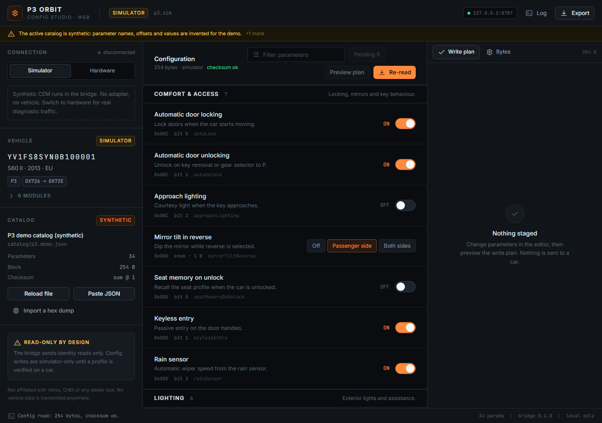

# P3Bench (web)

A local-first **P3 config studio** that runs in the browser. It is a small,
independent re-imagining of the "read the CarConfig block, show it as settings,
stage a change, preview the bytes, write it back" workflow — scoped to Volvo **P3** configuration research. The supplied simulator is
synthetic; no verified vehicle configuration-read profile is included.

Not affiliated with Volvo, OrBit, VIDA or any dealer tool. It does not use anyone
else's catalogue, protocol secrets or service.



```
┌───────────────────────────────┐        HTTP/JSON        ┌──────────────────────────┐
│  web/  React + Vite UI        │  ────────────────────►  │  bridge/  .NET 4.8 x86   │
│  localhost:5173 (dev)         │  ◄────────────────────  │  127.0.0.1:8787          │
│  or served by the bridge      │                         │  J2534 v04.04 + ISO-TP   │
└───────────────────────────────┘                         └────────────┬─────────────┘
                                                                       │ USB
                                                                  OBD adapter
```

The browser never touches hardware. The bridge owns the J2534 driver, so the UI
stays a normal web app and nothing on the network can reach a car.

## What is actually implemented

| Area | State |
| --- | --- |
| Simulator (synthetic P3 CEM, 254-byte block, checksum) | works end to end, read → edit → plan → apply |
| Config editor driven by a JSON catalogue | works (groups, bools, enums, u8/u16, ASCII) |
| Byte-level plan: old/new hex per change, checksum recompute | works |
| Undo the last simulated write (20-step history) | works, simulator only |
| Raw hex inspector with catalogue coverage + staged diff | works |
| Import a hex dump / import a catalogue from the UI | works |
| J2534 driver discovery, open/close, supply voltage | works (same code path as the P3ToolClone investigation) |
| `3E 00` tester present, `22 F1 90` VIN | implemented, **not vehicle-validated** |
| P3 config read over DID (`22 xx xx`) | only if a profile supplies a verified DID — none shipped |
| Config write to a vehicle | **deliberately not implemented** |

The bundled catalogue (`catalog/p3.demo.json`) is **synthetic demo data**:
invented parameter names, offsets and values. It exists so the UI can be used and
tested without a car. It is not a decode of any Volvo module and is not compatible
with OrBit.

## Run it

```cmd
start.cmd
```

That builds the bridge if needed, builds the web app if `web/dist` is missing,
then opens <http://127.0.0.1:8787/>. Bridge output stays in the console.

Development loop (hot reload):

```cmd
bridge\build.cmd
bridge\P3OrbitBridge.exe --port 8787
```
```cmd
cd web
npm install
npm run dev        :: http://localhost:5173, /api proxied to :8787
```

Options: `P3OrbitBridge.exe --port <n> --root <dir> --open`.

## Using it

The homepage at `/` introduces P3Bench and includes an interactive illustration
using synthetic data. It works without the bridge and makes no API requests.
Choose **Open studio** to enter the existing configuration app at `/app`.
Direct byte-inspector links use `/app#bytes`; legacy `/#bytes` links redirect there.
These routes work with both the Vite dev server and the bridge's static server.

The public homepage at `www.p3bench.tech` is built from `web/` by the
`Deploy P3Bench homepage` GitHub Actions workflow on each push to `main`.
GitHub Pages hosts the frontend only; the studio's working simulator and hardware
access require running the local bridge. The custom domain is retained in `CNAME`.

1. **Simulator** mode is selected at start. Press **Read config** — you get a
   254-byte block with a valid trailing sum.
2. Change settings. The editor tracks pending changes and never talks to the
   bridge until you press **Preview plan**.
3. **Preview plan** returns the authoritative diff: which bytes change, old → new
   hex, and the recomputed checksum byte (highlighted in the Bytes tab).
4. Type `APPLY` and apply. In simulator mode this writes to the in-memory block
   only, then re-reads it, so you can see the round trip. **Undo** restores the
   block from before the last simulated write.
5. **Export** (or `Ctrl+S`) saves block + catalogue id + warnings as JSON with
   provenance. **Import hex dump** decodes a block you captured elsewhere.
6. **Reset** discards pending editor changes without touching the loaded block.

Hardware mode adds adapter discovery (32-bit `PassThruSupport.04.04`), connect,
voltage, tester-present and VIN. Read/write of config stays blocked until a
profile has a verified read path; the UI shows exactly why.

## Safety model

The dangerous part of a tool like this is not the UI, it is the write path.

* `apply` refuses anything that is not simulator mode. There is no "force" switch.
* A plan is only staged from a block whose own checksum validates, and `apply`
  checks the candidate block again before writing. A corrupt dump can still be
  inspected but cannot be "repaired" silently.
* Numeric edits are range-checked against the catalogue **and** against the
  storage width after scaling, so a bad scale cannot truncate a byte.
* Every profile carries `validated` and `synthetic` flags. Anything unproven is
  surfaced in the header and blocks writes.
* Reading identity data (`3E`, `22 F1 90`) does not change the session, does not
  use security access and writes nothing.
* State-changing requests from a non-local browser origin are rejected, in
  addition to loopback-only binding. Static files are confined to `web/dist`.
* Nothing is uploaded. The bridge binds `127.0.0.1` only.

If you extend this with a real read plan: verify it on a bench module first, keep
raw captures with provenance, and never let a partial read look like a successful
backup. A wrong config write can disable safety systems, lighting or the
immobiliser, and can make the car illegal to drive.

## Layout

```
bridge/            C# .NET Framework 4.8 (x86, J2534 v04.04)
  Program.cs       HTTP routes + static serving
  App.cs           state machine, operations, safety gates
  Catalog.cs       catalogue model, validation, byte codec
  Plan.cs          edit → candidate block → byte diff
  Simulator.cs     synthetic P3 CEM
  J2534.cs         device + ISO 15765 channel
  IsoTp.cs         ISO-TP framing (shared with P3ToolClone)
  Profile.cs       connection profiles + profiles.local.json
  tests/           dependency-free logic tests (codec, plan, ISO-TP)
web/               React 19 + TypeScript + Vite + Tailwind 4
  src/App.tsx      shell, polling, draft/plan state
  src/components/  sidebar, editor, plan, hex, log, dialogs
catalog/p3.demo.json   synthetic demo catalogue
docs/             catalogue + profile formats
```

## HTTP API

All responses are JSON. Errors are `{ ok: false, error: { code, message } }`.

| Method | Path | Body | Purpose |
| --- | --- | --- | --- |
| GET | `/api/state` | – | full snapshot (mode, adapter, vehicle, catalogue, dump, plan) |
| GET | `/api/log?since=n` | – | bridge log since sequence |
| POST | `/api/mode` | `{ mode }` | `simulator` / `hardware` (must be disconnected) |
| GET | `/api/adapters` | – | state, including discovered drivers |
| POST | `/api/adapters/refresh` | – | rescan registry |
| POST | `/api/adapter/select` | `{ library }` | pick a driver |
| POST | `/api/connect` / `/api/disconnect` | – | open device, probe, read VIN |
| POST | `/api/read` | – | read the config block for the active profile |
| POST | `/api/dump/import` | `{ hex }` | decode a pasted block |
| POST | `/api/plan` | `{ edits: [{ id, value }] }` | build a write plan |
| POST | `/api/apply` | `{ planId, confirm: "APPLY" }` | apply (simulator only) |
| POST | `/api/undo` | – | restore the pre-write simulator block |
| POST | `/api/discard` | – | drop the staged plan |
| POST | `/api/catalog/reload` | – | reload `catalog/p3.demo.json` |
| POST | `/api/catalog/import` | `{ text }` | validate and use a pasted catalogue |

## Tests

Run the pure-logic tests (no adapter, no vehicle):

```cmd
bridge\tests\run.cmd
```

Run the HTTP smoke test (starts its own bridge on port 8799, exercises
simulator read → plan → apply → undo, validation, catalogue rejection, origin
checks and path containment, then stops it):

```cmd
powershell -NoProfile -ExecutionPolicy Bypass -File bridge\smoke.ps1
```

Build the web UI with `npm run build` inside `web/`. The build runs
`tsc --noEmit` first.

## Next steps that are safe

1. Replace the demo catalogue with one you can cite — offset by offset — from
   your own dumps (`docs/catalog.md`).
2. Add a verified read DID for your own car in `profiles.local.json`
   (`docs/profiles.md`) and keep the block read-only.
3. Only then design a write path: session handling, security access, retries,
   read-back verification and rollback, tested on a bench CEM.
